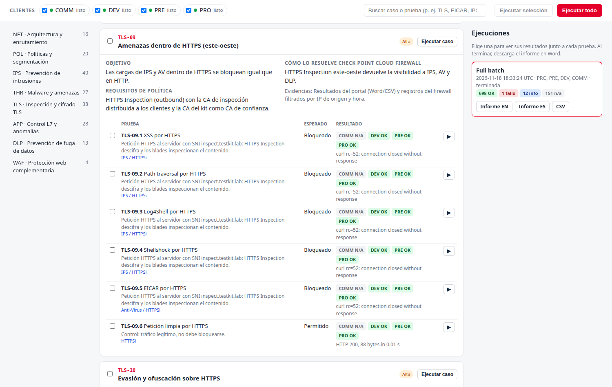
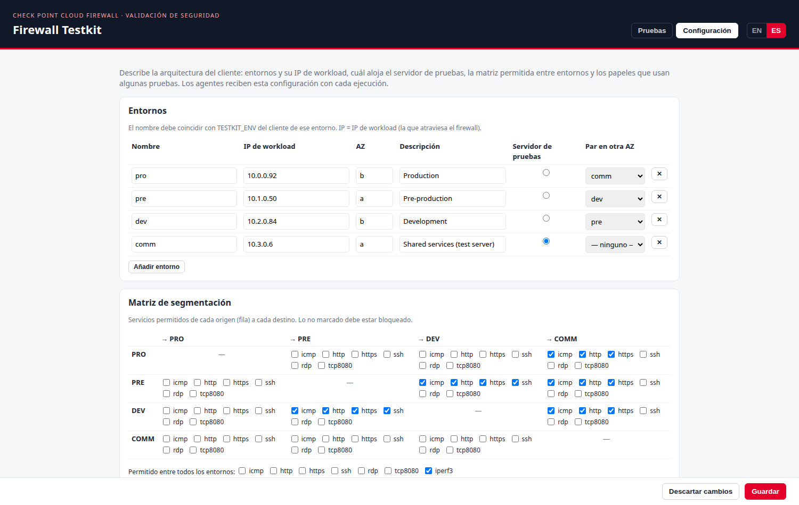
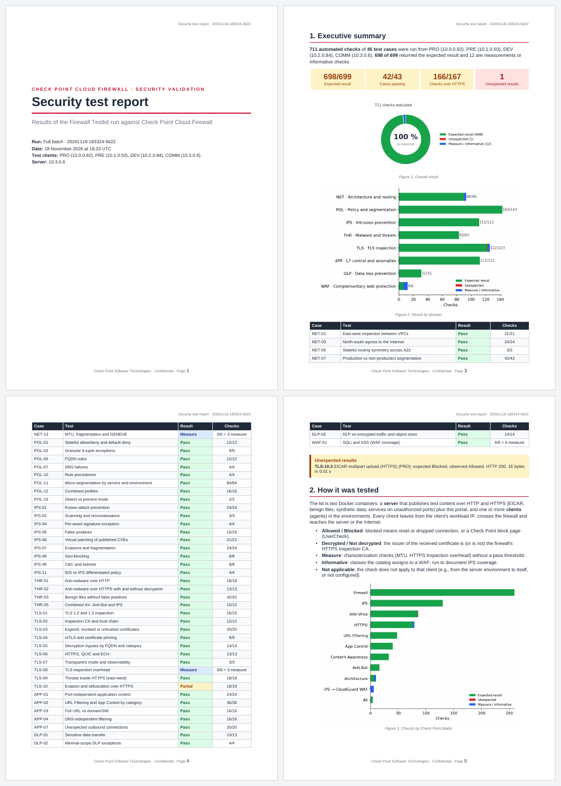

# Firewall Testkit

_English: [README.md](README.md)_

Kit portable en Docker para **validar un despliegue de Check Point Cloud Firewall** (segmentación este-oeste e
inspección de la salida, por ejemplo con AWS Transit Gateway y Gateway Load Balancer) con pruebas de seguridad
repetibles y explicadas, un portal web y un informe Word automático, en inglés y en español.



## Qué hace

- **186 comprobaciones automáticas en 45 casos de prueba** de 8 dominios: arquitectura y enrutamiento, políticas y
  segmentación, IPS, malware, **inspección TLS** (incluida la evasión sobre HTTPS), control de aplicaciones y URL,
  DLP y cobertura de WAF.
- Contenedor **servidor**: publica contenido de prueba por HTTP y HTTPS —EICAR en varios envoltorios, ficheros
  benignos de varios formatos, tarjetas e IBAN sintéticos, un ejecutable, servicios en puertos no autorizados, tres
  nombres TLS (`inspect.testkit.lab`, `nodecrypt.testkit.lab`, `mtls.testkit.lab`)— y aloja el **portal**.
- Contenedor **cliente** (uno por entorno): agente que ejecuta las pruebas desde la IP de workload, de modo que cada
  prueba atraviesa de verdad el firewall, y envía los resultados al portal.
- **Portal**: explicación de cada prueba; ejecución de una prueba, un caso, una selección o todo, en uno o varios
  clientes; histórico; CSV e **informe Word (ES/EN)**.
- **Configuración**: entornos e IP de workload, servidor de pruebas, matriz de segmentación, papeles que usan las
  pruebas ligadas a reglas concretas y destinos en Internet, para adaptar el mismo kit a arquitecturas distintas.

| Configuración | Informe Word |
|---|---|
|  |  |

## Arquitectura

Todo el tráfico de prueba sale de la IP de workload del cliente, atraviesa el firewall y llega a un servidor de
pruebas o a Internet. Los agentes hablan con el portal por el plano de datos (debe permitirse HTTP hacia el
servidor); los resultados viajan comprimidos y en base64 para que las cargas de ataque que contienen no disparen el
IPS. Diagrama en el [README en inglés](README.md#architecture).

## Puesta en marcha

Requisitos: Docker en una VM Linux por entorno (red del host) y HTTP permitido de los clientes al servidor.

```bash
git clone https://github.com/gdiaz777/cloud-firewall-testkit.git && cd cloud-firewall-testkit
./gen_certs.sh                      # CA del kit + certificado de cliente (certs/, no versionado)
# En el firewall (ver docs/es/configuracion-firewall.md):
#  - añadir certs/testkit_ca.crt como CA de confianza
#  - exportar la CA de HTTPS Inspection (parte pública) a certs/inspection_ca.crt
cp .env.example .env                # TESTKIT_ENV, SRC_IP, SERVER_IP, PORTAL, PORTAL_URL
docker compose --profile server up -d    # en la VM del servidor de pruebas (PORTAL=1)
docker compose --profile client up -d    # en cada VM de entorno (PORTAL=0)
```

Abre `http://<servidor>/portal/`, entra en **Configuración**, describe los entornos y pulsa **Ejecutar todo**.
Copia `certs/` a todas las VM. Para construir la imagen en local en vez de descargarla: `./build.sh` y
`TESTKIT_IMAGE=cloud-firewall-testkit:local` en `.env`.

Por consola (sin portal):

```bash
docker compose run --rm client list
docker compose run --rm client run IPS-01 TLS-05     # usa config/config.json de la imagen o TESTKIT_CONFIG
```

## Laboratorio completo con un comando

¿Tienes una gestora de Check Point con CME (p. ej. Smart-1 Cloud) y una cuenta de AWS vacía? `deploy/` lo construye
todo —VPC, Transit Gateway, GWLB y el grupo de autoescalado de Check Point Cloud Firewall, CME, la política
(segmentación, salida, best practices de Threat Prevention, HTTPS Inspection), el kit y el portal— y lanza las pruebas:

```bash
./deploy/setup.sh       # API key de la gestora, AWS, tamaño
./deploy/up.sh --run    # ~30–40 min; informes Word en reports/<id>/
./deploy/down.sh        # destruir
```

Ver [docs/es/despliegue.md](docs/es/despliegue.md).

## Configuración

Todo lo que depende del cliente está en **Configuración** del portal (se guarda en `/data/config.json` del servidor;
por defecto, `config/config.example.json`):

| Sección | Para qué |
|---|---|
| Entornos | Nombre (igual que `TESTKIT_ENV` del cliente), IP de workload, AZ, descripción, cuál aloja el servidor y su par en otra AZ |
| Matriz de segmentación | Servicios permitidos de cada origen a cada destino (`icmp`, `http`, `https`, `ssh`, `rdp`, `tcp8080`, `iperf3`); el resto debe bloquearse |
| Papeles | Entornos que usan las pruebas ligadas a reglas: producción / no producción, destino IDS (Detect), activo con excepción IPS, activo con excepción DLP, precedencia de reglas |
| Destinos en Internet | Sitios permitido y bloqueado, ruta bloqueada, URL geobloqueada, sitio financiero (bypass HTTPS), sitio inspeccionado, host de puertos, resolvedor DNS, puerto de excepción |

Las pruebas cuyo papel o destino está vacío aparecen como **no aplica**, no como fallo.

## Documentación

- [Catálogo de pruebas](docs/es/catalogo-pruebas.md): cada caso y prueba, generado desde `catalog/tests.json`
- [Desplegar un laboratorio completo](docs/es/despliegue.md): `deploy/`, desde la API key de la gestora hasta los resultados
- [Configuración del firewall](docs/es/configuracion-firewall.md): requisitos de política en Check Point Cloud Firewall, HTTPS Inspection y best practices

## Seguridad

Solo se usan estímulos inocuos: el fichero de prueba EICAR, patrones de ataque contra un servidor no vulnerable y
datos sintéticos (números de tarjeta de prueba e IBAN de ejemplo). Úsalo solo contra entornos que estés autorizado a
probar.

## Licencia

MIT: ver [LICENSE](LICENSE). No es un producto oficial de Check Point.
