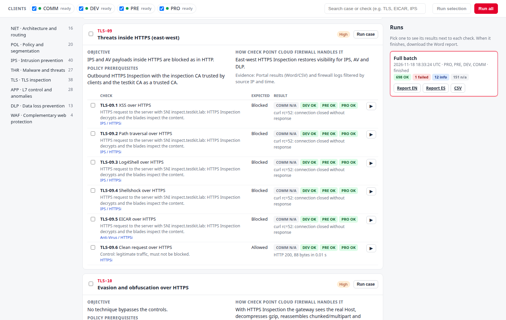

# Firewall Testkit

_Español: [README.es.md](README.es.md)_

A portable, vendor-neutral kit to **validate and compare network security solutions** (cloud firewalls, NGFWs,
east-west segmentation and egress inspection) with repeatable, explained tests, a web portal and Word reports in
English and Spanish.

Run one container as **test server** and one container as **client** in each network segment. Clients point at the
server, every test crosses the security solution, and the portal produces the report — whatever the architecture is.



## What it tests

**186 automated checks in 45 test cases** across 8 domains: architecture and routing, policy and segmentation,
intrusion prevention, malware, **TLS inspection** (including evasion over HTTPS), application/URL control, DLP and web
attack coverage. Only harmless stimuli are used (EICAR, attack patterns against a non-vulnerable server, synthetic
data). See the [test catalog](docs/en/test-catalog.md).

## Quick start

On the **test server** (Linux host with Docker):

```bash
docker run -d --name testkit-server --network host -v testkit-data:/data \
  ghcr.io/gdiaz777/cloud-firewall-testkit:latest server
```

On every **client** (one per network segment / environment):

```bash
docker run -d --name testkit-client --network host --cap-add NET_RAW --cap-add NET_ADMIN \
  -e SERVER=<server IP> ghcr.io/gdiaz777/cloud-firewall-testkit:latest client
```

Open `http://<server IP>/portal/` → **Settings**:

1. **Solution under test**: name (it labels runs and reports).
2. **Environments**: *Add connected clients*, then adjust names, CIDRs and the segmentation matrix (what each
   environment may reach). Leave empty what does not apply: those checks are reported as *not applicable*.
3. **TLS inspection CA**: paste the CA certificate the solution uses to re-sign inspected TLS (if any).
4. Save, go to **Tests** and click **Run all** — or run single checks and cases.

When a run finishes, download the **Word report (EN/ES)** or the CSV. Requirements: the clients must reach the server
over HTTP (tcp/80) through the solution; the server generates its own test CA and clients fetch it automatically.

Command line on a client (no portal needed): `docker exec testkit-client fw-tests run IPS-01 TLS-05`.
A `docker-compose.yml` with both profiles is included.

## Comparing solutions

Change **Solution under test** in Settings, run the batch again with the same clients, tick two or more runs in the
**Runs** panel and download the **comparison report**: overall and per-domain results, a verdict per case for every
solution and the list of checks where they differ. Results come from what the clients observe (reset, drop, block
page, certificate issuer), not from vendor logs, so the same yardstick applies to every vendor.

| Settings | Report |
|---|---|
|  |  |

## Optional: Check Point baseline

[`checkpoint/`](checkpoint/) configures a Check Point management (e.g. Smart-1 Cloud) from the portal settings with a
policy that follows Check Point best practices — segmentation matrix, egress control, threat prevention per flow type,
DLP and TLS inspection — and uploads the inspection CA to the portal:

```bash
cd checkpoint && ./cp-baseline.sh setup                       # management URL + API key
./cp-baseline.sh apply --portal http://<server IP>/portal --push-ca
./cp-baseline.sh install <gateway> …                         # or --prefix <name prefix>
```

See [docs/en/checkpoint-baseline.md](docs/en/checkpoint-baseline.md) and the [Check Point configuration guide](docs/en/firewall-setup.md).

## How it works

- **Server**: nginx on 80/443 with three TLS names (`inspect.testkit.lab`, `nodecrypt.testkit.lab`, `mtls.testkit.lab`),
  test content (EICAR variants, benign files, synthetic card numbers/IBANs, an executable), services on ports that
  should be blocked (22, 23, 3389, 8080), iperf3, and the portal.
- **Client**: an agent that runs the checks from its own IP and posts results to the portal (zlib+base64, so attack
  payloads in results do not trigger the IPS). It can also run as a CLI.
- **Catalog**: `catalog/catalog.py` → `tests.json`, bilingual; vendor-specific notes are kept apart and shown only when
  the solution under test is Check Point.

```
catalog/     catalog.py, tests.json, gen_docs.py
client/      runner.py (checks, agent, CLI)
server/      nginx, content, portal (Flask + JS), report (docx + matplotlib), comparison report
checkpoint/  optional Check Point baseline (Management API)
config/      default.json, config.example.json (4-environment example)
docs/        en/, es/, img/
```

Build locally: `./build.sh` (image `cloud-firewall-testkit:local`).

## Safety

Use it only on networks you are authorized to test. Every stimulus is harmless and every data set is synthetic.

## License

MIT — see [LICENSE](LICENSE). Not an official Check Point product.
