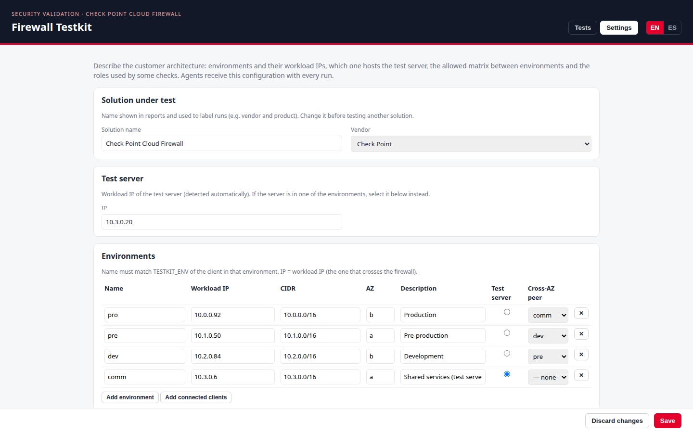
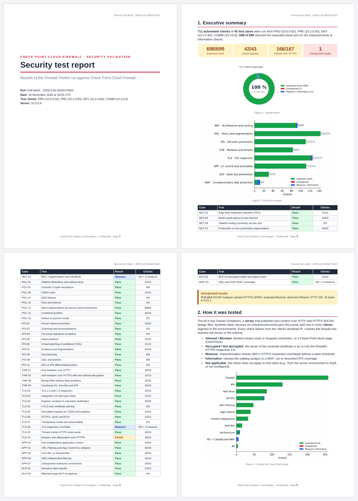
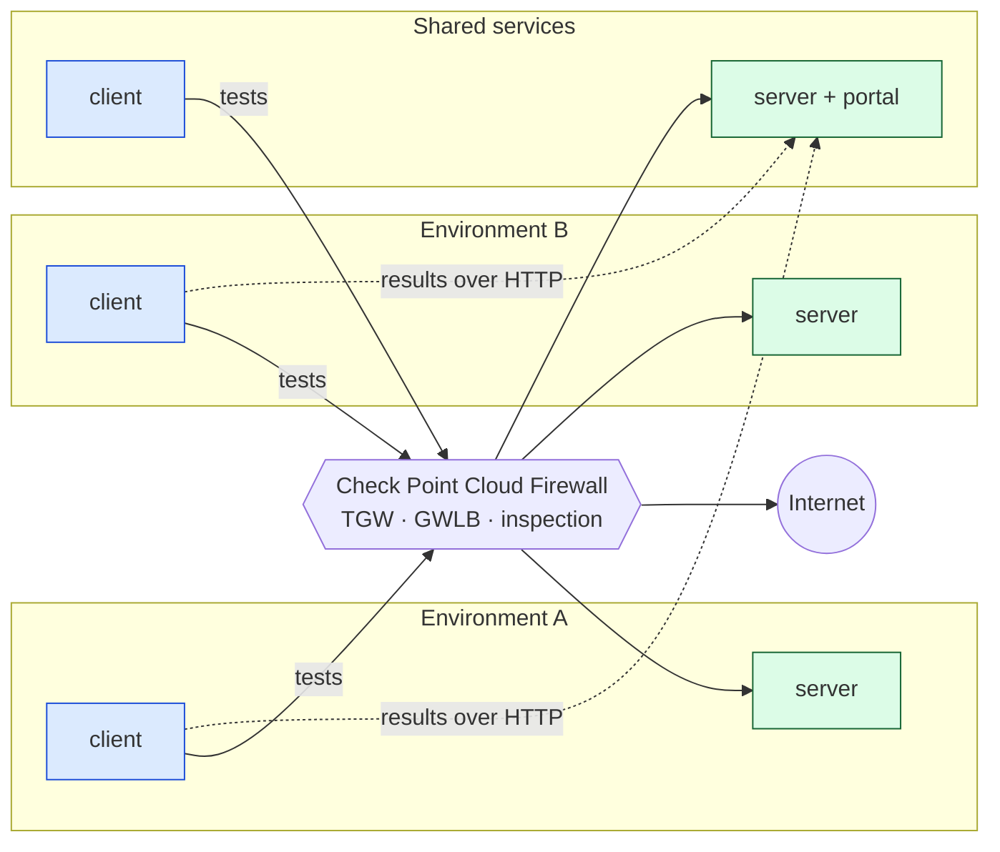

# Firewall Testkit

_Español: [README.es.md](README.es.md)_

A portable, Docker-based kit to **validate a Check Point Cloud Firewall deployment** (east-west segmentation and egress
inspection, e.g. AWS Transit Gateway + Gateway Load Balancer) with repeatable, explained security tests, a web portal
and an automatic Word report — in English and Spanish.


## What it does

- **186 automated checks in 45 test cases** across 8 domains: architecture and routing, policy and segmentation,
  IPS, malware, **TLS inspection** (including evasion over HTTPS), application/URL control, DLP and WAF coverage.
- **Server** container: publishes test content over HTTP and HTTPS — EICAR in several wrappers, benign files of
  several formats, synthetic card numbers and IBANs, an executable, services on unauthorized ports, three TLS names
  (`inspect.testkit.lab`, `nodecrypt.testkit.lab`, `mtls.testkit.lab`) — and hosts the **portal**.
- **Client** container (one per environment): an agent that runs the checks from the workload IP, so every test
  really crosses the firewall, and posts results to the portal.
- **Portal**: explanation of every check, run single checks, a case, a selection or everything on one or several
  clients, history, CSV and **Word report (EN/ES)**.
- **Settings**: environments and workload IPs, test server, segmentation matrix, roles used by policy-specific checks
  and Internet targets — so the same kit fits different customer architectures.

| Settings | Word report |
|---|---|
|  |  |

## Architecture



All test traffic leaves from the client's workload IP, crosses the firewall and reaches a test server or the Internet.
Agents talk to the portal over the data plane (HTTP to the server must be allowed); results are zlib+base64 encoded
so the attack payloads they contain do not trigger the IPS.

## Quick start

Requirements: Docker on one Linux VM per environment (host networking), HTTP from the clients to the server allowed
by the policy.

```bash
git clone https://github.com/gdiaz777/cloud-firewall-testkit.git && cd cloud-firewall-testkit
./gen_certs.sh                      # testkit CA + client certificate (certs/, not versioned)
# Firewall side (see docs/en/firewall-setup.md):
#  - add certs/testkit_ca.crt as a trusted CA
#  - export your HTTPS Inspection CA (public part) to certs/inspection_ca.crt
cp .env.example .env                # TESTKIT_ENV, SRC_IP, SERVER_IP, PORTAL, PORTAL_URL
docker compose --profile server up -d    # on the test server VM (PORTAL=1)
docker compose --profile client up -d    # on every environment VM (PORTAL=0)
```

Open `http://<server>/portal/`, go to **Settings** and describe the environments, then **Run all**.
Copy `certs/` to every VM. To build the image locally instead of pulling it: `./build.sh` and set
`TESTKIT_IMAGE=cloud-firewall-testkit:local` in `.env`.

CLI (no portal):

```bash
docker compose run --rm client list
docker compose run --rm client run IPS-01 TLS-05     # uses config/config.json inside the image or TESTKIT_CONFIG
```

## Full lab in one command

Have a Check Point management with CME (e.g. Smart-1 Cloud) and an empty AWS account? `deploy/` builds everything —
VPCs, Transit Gateway, GWLB and the Check Point Cloud Firewall autoscaling group, CME, the policy (segmentation,
egress, Threat Prevention best practices, HTTPS Inspection), the testkit and the portal — and runs the tests:

```bash
./deploy/setup.sh       # management API key, AWS, sizing
./deploy/up.sh --run    # ~30–40 min; Word reports in reports/<run-id>/
./deploy/down.sh        # destroy
```

See [docs/en/deploy.md](docs/en/deploy.md).

## Configuration

Everything that depends on the customer lives in the portal **Settings** (stored in `/data/config.json` on the
server; default `config/config.example.json`):

| Section | Purpose |
|---|---|
| Environments | Name (must match `TESTKIT_ENV` of the client), workload IP, AZ, description, which one hosts the server, cross-AZ peer |
| Segmentation matrix | Services allowed from each source to each destination (`icmp`, `http`, `https`, `ssh`, `rdp`, `tcp8080`, `iperf3`); the rest must be blocked |
| Roles | Environments used by checks tied to specific rules: production / non-production, IDS (Detect) target, IPS exception asset, DLP exception asset, rule precedence |
| Internet targets | Allowed and blocked sites, blocked path, geo-blocked URL, financial site (HTTPS bypass), inspected site, port test host, DNS resolver, exception port |

Checks whose role or target is empty are reported as **not applicable** instead of failing.

## Documentation

- [Test catalog](docs/en/test-catalog.md) — every case and check, generated from `catalog/tests.json`
- [Deploy a complete lab](docs/en/deploy.md) — `deploy/`: from a management API key to test results
- [Firewall setup](docs/en/firewall-setup.md) — Check Point Cloud Firewall policy prerequisites, HTTPS Inspection and best practices

## Repository layout

```
catalog/   catalog.py (source, bilingual) → tests.json; gen_docs.py → docs/*/catalog
client/    runner.py (checks, CLI and agent)
server/    nginx, test content generator, body sink, portal (Flask + vanilla JS), report (docx + matplotlib)
config/    config.example.json
deploy/    setup.sh, up.sh, run.sh, down.sh, lab.example.json, mgmt/ (Management API + CME), terraform/ (AWS lab)
docs/      en/, es/, img/
```

## Safety

Only harmless stimuli are used: the EICAR test file, attack patterns sent to a non-vulnerable server and synthetic
data (card-brand test numbers, sample IBANs). Run it only against environments you are authorized to test.

## License

MIT — see [LICENSE](LICENSE). Not an official Check Point product.
