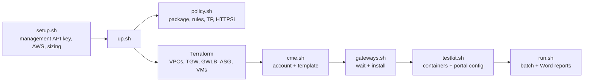

# Deploy a complete lab

_Español: [despliegue.md](../es/despliegue.md)_

`deploy/` builds a full test lab from scratch in a dedicated AWS account and configures your Check Point management:
infrastructure, CME, policy, HTTPS Inspection, best practices, gateways, the testkit and the portal. Then you run the
tests from the portal or with one command.



## Prerequisites

- **A Check Point management** reachable over the Management API with **CME** (e.g. a Smart-1 Cloud tenant) and an
  **API key** with read-write permissions. Use a management dedicated to the lab: the kit creates its own policy
  package and changes global HTTPS Inspection settings (server-certificate validation, outbound CA if none exists).
- **An AWS account** dedicated to the lab and credentials with administrator rights (environment variables or a profile).
  The default lab costs roughly the price of 2 × c5n.xlarge PAYG gateways + 4 small VMs + GWLB/TGW/NAT per hour.
- Local tools: `terraform` ≥ 1.5, `jq`, `curl`, `openssl`, `ssh`.
- Accept the Check Point Cloud Firewall (CloudGuard Network Security) PAYG AMI terms in AWS Marketplace for that account.

## Steps

```bash
./deploy/setup.sh            # asks for the management web API URL and API key, AWS profile/region, prefix, sizing
vi deploy/state/lab.json     # optional: environments, segmentation matrix, roles, Internet targets
./deploy/up.sh --run         # builds everything (~30–40 min) and runs the full batch
./deploy/run.sh              # run again later; reports in reports/<run-id>/
./deploy/down.sh             # destroy (add --purge-policy to delete the policy package and kit objects)
```

`up.sh --from N` resumes at a step (1 preflight, 2 certificates, 3 policy, 4 Terraform, 5 CME, 6 gateways, 7 testkit).

## What gets created

| Where | Objects |
|---|---|
| Management | Package (default `FW_Testkit`) with access layer, inline egress layer `TK Egress Internet`, threat profiles `TK_EastWest` / `TK_Strict` / `TK_Detect`, HTTPS layer `TK HTTPS Outbound`, networks `TK_<env>`, group `TK_Envs`, services and custom sites `TK_*`, GEO and bypass updatable objects, the testkit CA as trusted CA, an outbound inspection CA (if none) |
| CME | AWS account `<prefix>-aws` (STS read-only role with external ID) and template `<prefix>-tpl` with HTTPS Inspection |
| AWS | One VPC + test VM per environment, inspection VPC (GWLB endpoints, appliance mode), egress VPC (NAT GW per AZ), firewall VPC (GWLB + autoscaling group), Transit Gateway with spokes/inspection route tables, IAM user/role for CME |

## lab.json

The single design file. `environments` (name, /16 CIDR, AZ a|b) drives Terraform; `segmentation.allow` becomes one
Accept rule per pair; `roles` place the IDS (Detect) rule, the IPS and DLP exceptions; `internet` defines the custom
sites and GEO objects. The same file (plus the VM IPs) is loaded into the portal Settings, so policy and expected
results always match.

## Notes

- Name prefix ≤ 10 characters (the GWLB name is built from it).
- Gateways need 10–20 minutes after Terraform to be registered by CME; `gateways.sh` waits up to 40 minutes.
- Secrets stay local: `deploy/settings.env`, `deploy/.ssh/`, `certs/` and the Terraform state are git-ignored.
- Third-party Terraform modules in `deploy/terraform/modules/checkpoint` come from CheckPointSW (Apache-2.0), with the
  changes listed in its NOTICE.md.

## Accounts that forbid IAM access keys

CME (also in Smart-1 Cloud) always needs AWS access keys. If an SCP denies `iam:CreateAccessKey` in the lab account, use
a **broker user in another account**: an IAM user whose only permission is `sts:AssumeRole` on
`arn:aws:iam::<lab-account>:role/<prefix>-cme-role`. In `deploy/settings.env`:

```
CME_ACCESS_MODE=role
CME_TRUSTED_PRINCIPALS=arn:aws:iam::<broker-account>:user/<broker-user>
CME_BROKER_ACCESS_KEY_ID=...
CME_BROKER_SECRET_ACCESS_KEY=...
```

Terraform then creates only the read-only role (trusting the broker user with the external ID) and CME uses the broker keys.
Corporate SCPs may also require IMDSv2 and gp3 volumes: the lab already uses both.
